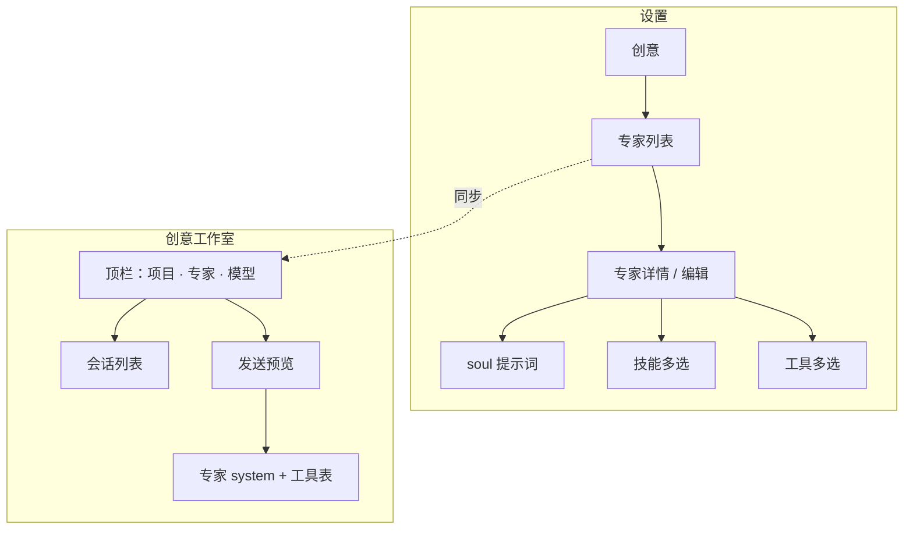

# 创意「专家」功能 — UI/UX 设计（v0）

> 目标：在创意会话中用户可选一个**专家**（Expert），由专家自带的 **soul / 系统提示词**、**技能白名单**、**工具白名单** 约束 Pi 行为；系统工具 **`list_experts`** 始终可用，帮用户发现与切换专家。  
> 本文仅设计交互与界面，不绑定最终实现路径。

---

## 1. 概念与边界

| 概念 | 含义 | 与现状关系 |
|------|------|------------|
| **专家** | 可复用的「角色包」：`soul.md`（系统提示词）+ 允许的技能 id 列表 + 允许的工具名列表 | 独立于「顶栏偏好技能」「自动（技能目录）」 |
| **偏好技能** | 单一 Agent 包，优先 `read_skill_text` | 专家选中后，**偏好技能 chip 收起或只读展示**，避免两套规则打架 |
| **自动（技能目录）** | 无专家、无偏好时的默认 Pi 行为 | 创意顶栏「专家 = 无」时等同今日自动模式 |
| **`list_experts`** | **系统内置**，返回专家目录 | **任何模式下都注入**，**不可**在专家工具勾选里关掉；有专家时仍保留，供用户换专家 |
| **`list_installed_skills`** | 技能目录 | **非**系统强制保留；仅当专家在「工具」里勾选时才可用（默认可不选，因专家已限定技能名单） |

**专家选中后的运行时规则（已锁定，供检查器与实现对照）：**

1. **System** = **仅**专家 `soul` 全文（可含占位：项目名、集号、专家名）。**不再**拼接 `buildCreativePiSystemAutonomous()`、顶栏偏好技能说明或其它通用创意壳。  
2. **技能** = **仅**专家配置的技能 id 集合；Pi 只能对这些 id 使用 `read_skill_text` / `read_skill`（名单外读技能应 `ok:false`）。**不**再使用顶栏「偏好技能」、**不**默认 `list_installed_skills` 扫全库（除非专家自己在 soul 里写流程且专家工具白名单里勾了 `list_installed_skills`）。  
3. **Tools** = 专家勾选的工具 **加上** 系统内置且 **不可关闭** 的 **`list_experts`**（列出有哪些专家，帮用户选用）。`list_experts` 不属于专家可选工具表，由平台永远注入。  
4. **发送预览** 必须与真发一致：system = 专家 soul；工具列表 = 专家工具 ∪ `{ list_experts }`；技能名单 = 专家技能列表。

---

## 2. 信息架构



**存储（设计意图，非实现）：**

- 内置专家：仓库 `experts/<id>/soul.md` + `manifest.json`（技能/工具默认集）。  
- 用户专家：`settings.experts[]` 或 SQLite `creative_experts`，覆盖/新增 id。  
- 会话级：`creative_sessions.expert_id`（可空 = 跟顶栏选择；非空 = 绑定到会话，切换项目仍记住）。

---

## 3. 设置 → 专家（管理端 UX）

### 3.1 列表页（卡片网格）

复用 **SkillHub 已安装卡片** 视觉：`skill-market-toolbar` 搜索 + 卡片网格。

| 元素 | 说明 |
|------|------|
| 顶栏说明 | 「专家打包 soul、技能与工具；创意顶栏选一个专家后，发送预览与 Pi 行为按专家生效。」 |
| 搜索 | 按名称、id、标签、描述 |
| 主按钮 | **+ 新建专家**（右侧，与技能市场「新会话」同级权重） |
| 卡片内容 | 名称、一句话描述、**技能 N · 工具 M**、来源（内置 / 自定义）、更新时间 |
| 卡片操作 | 点卡片 → 详情抽屉/全屏；⋯ → 复制 id、导出 zip、删除（内置只读） |

空态：插画 + 「还没有专家」+ 引导「从模板创建」或「新建空白专家」。

### 3.2 详情页（单专家编辑）

采用 **Skill 详情壳**（`skillDetailShell`）：左侧元数据，右侧主内容 **Tab**。

| Tab | 内容 |
|-----|------|
| **概览** | id（只读或可改一次）、显示名、描述、标签；「恢复内置默认」 |
| **Soul** | `soul.md` 编辑器：等宽、行号可选；说明「即发给模型的 system，可写 Markdown」；预览折叠区 |
| **技能** | 已安装技能多选列表（搜索 + 全选 Agent 包）；提示「Pi 仅可对勾选 id 读 SKILL」 |
| **工具** | 分组勾选（见 §3.3） |
| **高级** | JSON 只读审计、导出、删除 |

底部固定：**保存**（显式落库）、未保存离开拦截。

### 3.3 工具选择器 UX（核心）

**分组结构（Accordion 或左右栏）：**

1. **系统保留（不在本页勾选）**  
   - `list_experts` 由平台始终注入，**不出现在专家工具多选列表**；设置页仅文案说明「创意运行时永远可用」。

2. **平台内置**（默认 **全开**，可逐项去掉）  
   - 读：`read_source` … `list_camera_lexicon` …  
   - 写：`submit_*`  
   - `validate_contract`、`read_skill`、`read_skill_text`  
   - 组头操作：**「恢复平台默认」**（全选内置组）

3. **MCP（创意聊天）**  
   - 动态列表，默认 **不选**；专家可勾选允许的 `mcp.*`

4. **技能声明工具**（可选）  
   - 从已选技能 manifest 合并展示，默认跟技能走；高级用户可微调

**交互细节：**

- 关掉某项时，若 soul 正文里提到该工具，右侧显示弱提示「soul 中提及 read_shots，但未勾选」。  
- 计数：`已选 12 / 平台 18 · MCP 2`  
- 与创意会话一致：工具名与 `builtinPlatformToolNames()` 同源，避免检查器与真发不一致。

---

## 4. 创意工作室 → 专家选择 UX

### 4.1 顶栏布局（在现有 chip 行扩展）

现有：`模型` · `偏好（自动/技能）` · `技能市场` · `MCP` · `发送预览`

调整为：

```
[会话]  会话标题                    [状态 pill]
项目「xxx」· 第 1 集 · 仅显示本会话
[模型 ▼] [专家 ▼] [偏好技能 ▼ 仅当专家=无时显示]  …  [发送预览]
```

| 控件 | 行为 |
|------|------|
| **专家 ▼** | 第一项：**无专家（自动）**；分隔线；内置/自定义专家；底部 **管理专家…** → 设置 |
| 选中专家 | Chip 高亮；**隐藏「偏好技能」**；行为仅 soul + 专家技能 + 专家工具 + `list_experts` |
| 无专家 | 保持当前「自动 + 技能目录 + 可选偏好技能」逻辑 |

**会话记忆：** 切换专家写入 `localStorage` / 会话 `expert_id`；切项目时若会话绑定了 expert，顶栏跟会话走。

### 4.2 空对话与快捷话术

空态步骤增加一条：「选好**专家**或让 Pi `list_experts` 推荐」。

快捷短语：

- `list_experts` 帮我选一个专家  
- （有专家时）按当前专家 soul 开始  

### 4.3 发送预览（检查器）

选中专家时 **概览 Tab** 首行：

| 字段 | 展示 |
|------|------|
| 专家 | `分镜教练 · expert-shot-coach` |
| System | soul 全文（可复制） |
| 允许技能 | id 列表 + 「需在名单内 read」 |
| 允许工具 | 排序列表；**固定保留** `list_experts` 标注 🔒 |
| 本轮任务 | 不变（Pi 记忆 + user 草稿） |

未选专家：沿用现有 `buildCreativePiSystemAutonomous()` 预览。

### 4.4 Pi 与 `list_experts` 工具（产品文案）

**工具描述（写入 stageTools）：**

> 列出当前可用专家（id、名称、描述、技能数、工具数）。用户未选专家或想更换时，先调用本工具，用中文推荐 1～2 个 id，并在创意顶栏切换「专家」。

**System 补充句（有专家时 appended 或写在 soul 模板）：**

> 当前专家：{name}。不得假装具备未勾选的工具；读技能仅限专家技能名单。

**System 补充句（无专家时保留）：**

> 可 `list_experts` 帮用户选专家；选后在界面切换，无需在对话里维护状态机。

---

## 5. 默认专家模板（建议内置 2～3 个）

| id | 名称 | 默认技能 | 默认工具 |
|----|------|----------|----------|
| `expert-free-chat` | 自由创意 | （空，靠目录） | 平台读 + `list_*` + `read_skill_text`，无 submit |
| `expert-storyboard` | 分镜教练 | 若干 shotlist 相关包 | 读项目 + `submit_shots` + validate |
| `expert-character` | 角色设定 | character 相关包 | read/submit characters |

每个内置专家自带 `soul.md` 范例，用户可复制为自定义专家起点。

---

## 6. 状态、错误与权限

| 场景 | UX |
|------|-----|
| 专家被删但会话仍引用 | 顶栏显示「专家已失效」；退回自动；发送预览标红 |
| 专家技能 id 已卸载 | 详情页黄条；创意发送前不阻断，工具读技能时 `ok:false` |
| 专家工具全关只剩 list_experts | 允许保存；空态提示「至少建议保留读技能与一项读项目」 |
| 无项目 | 与现有一致：无会话；专家选择可禁用或仅预览 |

---

## 7. 线框（ASCII）

### 设置 — 专家列表

```
┌─ 设置 · 创意 ─────────────────────────────────────────┐
│ 专家                                                   │
│ 打包 soul、技能与工具，供创意顶栏选用。                │
│ [搜索…………………]  共 5 个              [ + 新建专家 ]     │
│ ┌─────────┐ ┌─────────┐ ┌─────────┐                  │
│ │分镜教练 │ │角色设定 │ │自由创意 │                  │
│ │内置     │ │自定义   │ │内置     │                  │
│ │技能 2   │ │技能 1   │ │技能 0   │                  │
│ │工具 14  │ │工具 8   │ │工具 6   │                  │
│ └─────────┘ └─────────┘ └─────────┘                  │
└────────────────────────────────────────────────────────┘
```

### 设置 — 专家详情 · Soul Tab

```
┌─ 分镜教练 ─────────────────────────────────────────────┐
│ [概览] [Soul●] [技能] [工具]                            │
│ ┌──────────────────────────────────────────────────┐  │
│ │ # 你是分镜教练…                                     │  │
│ │ 1. 先 list_installed_skills …                    │  │
│ │ 2. read_skill_text …                             │  │
│ └──────────────────────────────────────────────────┘  │
│                              [恢复内置 soul] [保存]    │
└────────────────────────────────────────────────────────┘
```

### 创意 — 顶栏

```
项目「短剧A」· 第 1 集
[模型 DeepSeek ▼] [专家 分镜教练 ▼] [发送预览]
```

---

## 8. 实现分期建议（供排期）

| 阶段 | 交付 |
|------|------|
| **P0** | 数据模型 + 设置列表/详情（Soul+工具默认勾选）+ 创意专家下拉 + 检查器切换 system/tools |
| **P1** | `list_experts` 工具 + 技能白名单 enforcement + 内置 3 模板 |
| **P2** | 会话级 expert_id、导入导出、soul 占位符（项目/集） |

---

## 9. 验收要点（UX）

- [x] 新建专家：平台工具默认全选，可去掉后保存，创意检查器工具列表一致。  
- [x] 选专家后：发送预览 system = soul，且仍含 `list_experts`。  
- [x] 选「无专家」：行为与当前自动模式一致。  
- [x] 设置与创意顶栏专家列表同源、同序。  
- [x] 卡片/搜索/详情壳与技能市场视觉一致（`skill-market-*` / `skillDetailShell`）。

---

## 10. 已确认的产品决策

| 决策 | 结论 |
|------|------|
| 选专家后的 system / 技能 | **仅**专家 soul + **仅**专家技能名单 |
| `list_experts` | **系统内置**，运行时**永远保留**，不进专家工具勾选 |
| 选专家 vs 偏好技能 | 有专家时 **隐藏偏好技能**，不双轨 |
| `list_installed_skills` | **非**强制；由专家工具白名单决定是否可用 |
| 会话级 expert | **已实现** `creative_sessions.expert_id` + 顶栏写回 |

OpenSpec：`creative-experts` 已归档（`openspec/changes/archive/2026-11-14-creative-experts/`），主 spec：`openspec/specs/creative-experts/spec.md`。